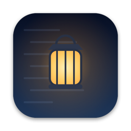
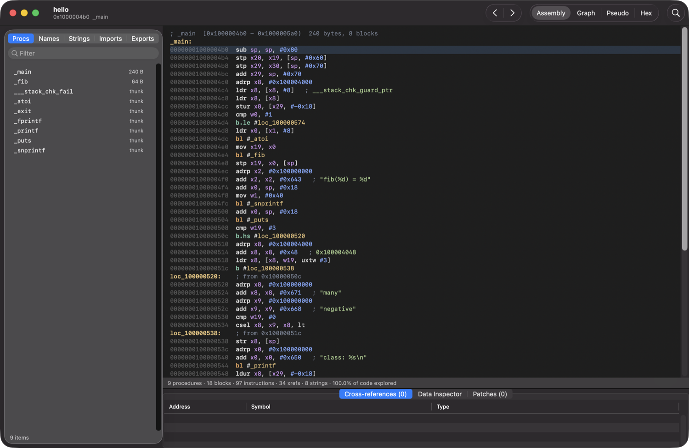
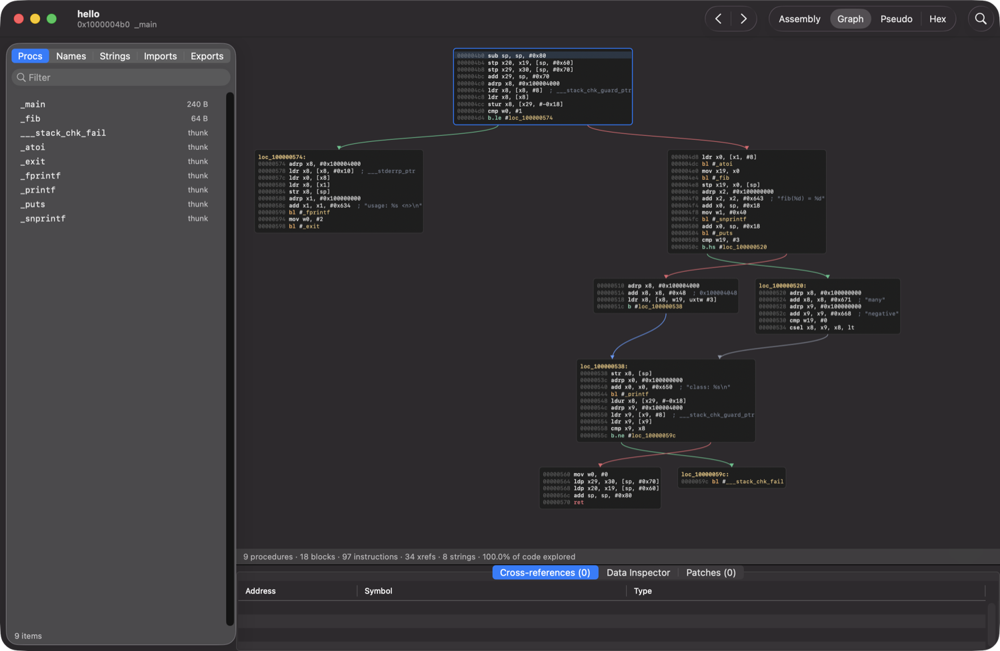
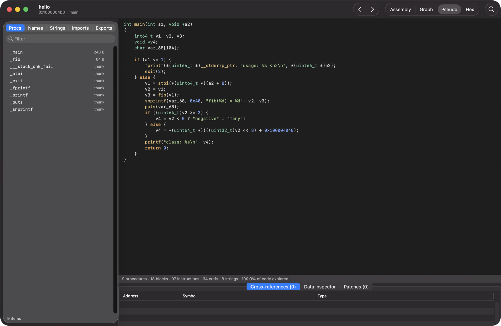

<div align="center">



# Lantern

**A native macOS disassembler and decompiler — fast, keyboard-driven, and open source.**

[](https://github.com/blazfxx/lantern/actions/workflows/ci.yml)
[](LICENSE)
-lightgrey)




</div>

Lantern opens Mach-O, ELF and PE binaries in a genuinely native Mac app — AppKit, system dark/light mode, a real toolbar and sidebar —
and shows you procedures, control-flow graphs, cross-references and decompiled pseudo-C. Analysis is done by the open-source
[Erebus](https://github.com/blazfxx/erebus) engine, bundled inside the app.

## Features

- **Everything one click (or key) away** — a sidebar of procedures, names, strings, imports and exports with instant filtering; assembly,
  graph, pseudo-code and hex views; back/forward history; a **command palette** (⇧⌘P) to jump to any symbol or run any command.
- **Assembly listing** with syntax colouring, clickable symbols, string and symbol annotations, comments, optional opcode bytes.
- **Control-flow graph** drawn natively: layered layout, green/red branch edges, pan & zoom, double-click a call to follow it.
- **Pseudo-code**: structured `if` / `while` / `switch` C with named variables, recovered call arguments and Objective-C message sends.
- **Inspector**: cross-references, a data inspector (ints, floats, strings at the cursor) and a patch list.
- **Patching**: assemble an instruction in place, patch bytes, revert, re-analyse, and **export a patched, re-signed binary**.
- **Formats & architectures**: Mach-O (thin/fat, arm64 · arm64e · x86-64), ELF, PE; Objective-C and Swift names are recovered.
- **Private & local**: binaries are analysed on your machine and never executed; analysis results are cached per file.

<table>
<tr>
<td width="50%"><br><sub><b>Control-flow graph</b></sub></td>
<td width="50%"><br><sub><b>Pseudo-code</b></sub></td>
</tr>
</table>

## Install

### Download

Get `Lantern-<version>-macos-arm64.dmg` from [Releases](https://github.com/blazfxx/lantern/releases) and drag **Lantern** to *Applications*.
The app is ad-hoc signed, not notarized — on first launch use **right-click → Open**, or run
`xattr -dr com.apple.quarantine /Applications/Lantern.app`.

Requires macOS 13+ on Apple silicon (Intel Macs: build from source).

### Build from source

```sh
brew install cmake ninja capstone cpp-httplib nlohmann-json
git clone --recurse-submodules https://github.com/blazfxx/lantern && cd lantern
scripts/build-app.sh --zip --dmg        # -> dist/Lantern.app (+ .zip / .dmg)
```

Optional: `brew install keystone` enables *Assemble Instruction* (the engine loads it at runtime; it is not bundled because it is GPL).

## Using Lantern

Open a binary with **File → Open…** (⌘O), by dropping it on the window or Dock icon, or via *Open With → Lantern*. You can open an `.app` bundle directly — Lantern analyses its main executable. Fat binaries ask which
architecture to analyse.

| Key (in a listing) | Action | | Menu / shortcut | Action |
|---|---|---|---|---|
| `G` | go to address or name | | ⇧⌘P | command palette |
| `N` | rename (hover a symbol) | | ⌘1 ⌘2 ⌘3 ⌘4 | assembly · graph · pseudo · hex |
| `;` | comment | | ⌘[ / ⌘] | back / forward |
| `X` | cross-references | | ⌘L | go to… |
| `Space` | toggle assembly ⇄ graph | | ⌘F | filter the sidebar |
| `Tab` | toggle assembly ⇄ pseudo-code | | ⇧⌘E | export patched binary |
| `A` / `P` / `U` | assemble / patch bytes / revert | | ⇧⌘R | re-analyse |
| `B` | show opcode bytes | | ⇧⌘C | copy pseudo-code |

Click any symbol to follow it. Databases live in `~/Library/Application Support/Lantern/Databases` (delete them to reclaim space).

## How it works

Lantern is a thin native front end; each window runs the bundled engine and talks to it over a private loopback JSON API:

```
Lantern.app (Swift/AppKit)  ⇄  erebus serve  (loaders → analysis → decompiler → SQLite)
```

See [docs/ARCHITECTURE.md](docs/ARCHITECTURE.md). The app has a headless end-to-end test: `Lantern --self-test <binary>`.

## Limitations

Early software. Variables in pseudo-code are `a1`/`v1`-style with only int/pointer typing, there is no struct recovery or debugger, only
arm64/x86 are supported, and the graph has no minimap yet. Decompiler output is a reading aid — verify against the disassembly.
Analysis bugs go to [Erebus](https://github.com/blazfxx/erebus/issues); UI bugs here.

## Contributing

Issues and pull requests are welcome: [CONTRIBUTING.md](CONTRIBUTING.md) · [Code of Conduct](CODE_OF_CONDUCT.md) · [Security](SECURITY.md).

## License & credits

[MIT](LICENSE) © 2026 blazfoxx. Lantern bundles the [Erebus](https://github.com/blazfxx/erebus) engine (MIT), which builds on Capstone (BSD-3),
cpp-httplib (MIT), nlohmann/json (MIT) and SQLite — see [THIRD_PARTY_NOTICES.md](THIRD_PARTY_NOTICES.md).
Lantern is an independent project, not affiliated with or endorsed by Cryptic Apps (Hopper), Hex-Rays (IDA), the NSA (Ghidra) or Apple,
and contains no code or assets from them. Use it only on software you own or are authorized to analyse.
